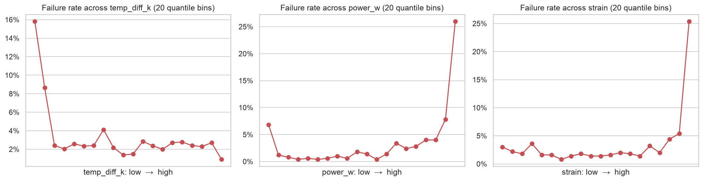
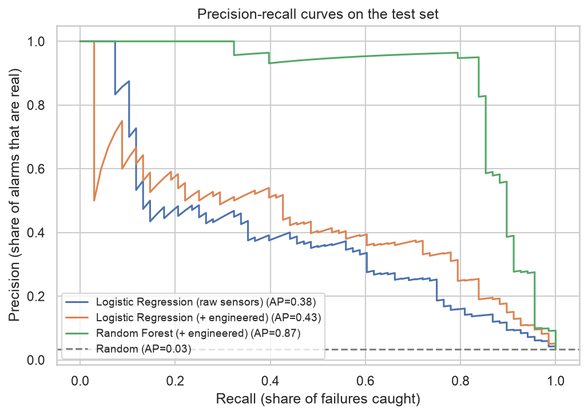
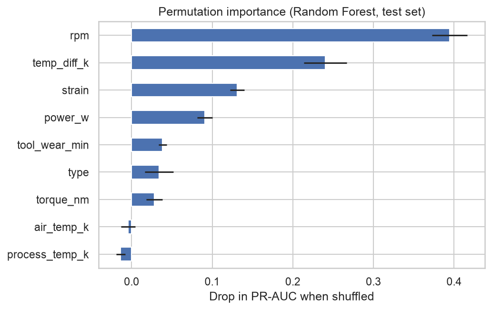

# Predictive Maintenance 🔧

Predicting machine failures from sensor data, so maintenance can be planned **before** a machine breaks down.

The project covers the full data science workflow in one notebook: exploratory analysis, physics-based feature engineering, model comparison on a strongly imbalanced target, threshold tuning without test-set leakage, and model explanation with permutation importance.

**Stack:** Python · pandas · scikit-learn · matplotlib · seaborn · Jupyter

👉 **[Open the notebook](predictive_maintenance.ipynb)**

## Data

[AI4I 2020 Predictive Maintenance Dataset](https://archive.ics.uci.edu/dataset/601) (UCI Machine Learning Repository, CC BY 4.0): 10,000 records from a milling machine with

- air and process temperature, rotational speed, torque, tool wear
- product quality type (L / M / H)
- whether the machine failed, and by which failure mode

Only about 3% of the records are failures, which makes accuracy a misleading metric.

## Approach

1. **Exploration:** distributions of each sensor for failure vs. no failure, failure modes, class imbalance
2. **Feature engineering** based on how the machine works:

   | Feature | Formula | Captures |
   |---|---|---|
   | `temp_diff_k` | process temp − air temp | poor heat dissipation |
   | `power_w` | torque × rpm × 2π / 60 | too little or too much power |
   | `strain` | tool wear × torque | worn tool under high load |

3. **Modelling:** baseline vs. logistic regression vs. random forest, with a stratified train/test split and class weighting. Failure-mode flags are excluded to avoid **data leakage**.
4. **Metrics for imbalanced data:** PR-AUC, recall and precision instead of accuracy
5. **Threshold tuning** with out-of-fold predictions from 5-fold cross-validation on the training set, so the test set is used only once
6. **Explanation** with permutation importance on the test set



## Results

Test set (2,000 records, stratified), decision threshold 0.5:

| Model | PR-AUC | Recall | Precision | F1 |
|---|---|---|---|---|
| Baseline (always "no failure") | 0.034 | 0.000 | 0.000 | 0.000 |
| Logistic Regression (raw sensors) | 0.382 | 0.824 | 0.142 | 0.242 |
| Logistic Regression (+ engineered) | 0.430 | 0.882 | 0.179 | 0.298 |
| **Random Forest (+ engineered)** | **0.874** | **0.809** | **0.948** | **0.873** |

**Takeaways:**
- The random forest catches about 4 out of 5 failures, and almost every alarm it raises is a real failure (precision 0.95).
- Logistic regression also catches many failures, but only 14–18% of its alarms are real: a linear model can't express rules like "failure at *both* very low and very high power".
- The physics-based features improve the linear model (PR-AUC 0.382 → 0.430) and give the random forest the right thresholds to split on.

<p>
  
  
</p>

## Run it yourself

Requires Python 3.9 or newer.

```bash
git clone https://github.com/MertErbasaran/predictive-maintenance.git
cd predictive-maintenance
python -m venv .venv
source .venv/bin/activate        # Windows: .venv\Scripts\activate
pip install -r requirements.txt
jupyter notebook predictive_maintenance.ipynb
```

The dataset is downloaded automatically on the first run and cached in `data/`.

## Project structure

```
predictive_maintenance.ipynb   the analysis
pm/
  data.py        download and load the AI4I 2020 dataset
  features.py    physics-based feature engineering
figures/         plots saved by the notebook
```

## Limitations and next steps

- AI4I 2020 is a synthetic dataset modelled on real machines, so real sensor data will be noisier.
- The records are snapshots, not time series. With real data, trends over time would be valuable features.
- The threshold could be set from actual costs (downtime vs. inspection) instead of maximizing F1.
- Next: gradient boosting (e.g. LightGBM) and predicting the failure mode as a multi-class problem.
